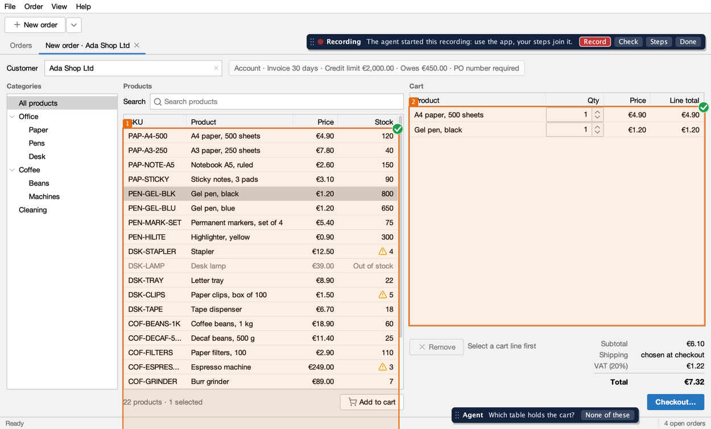
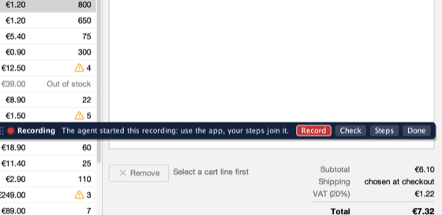
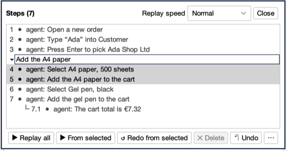
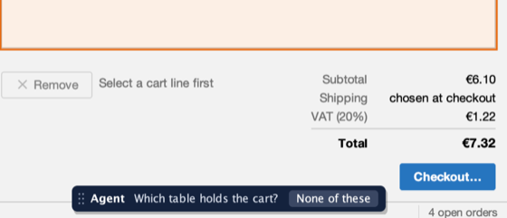
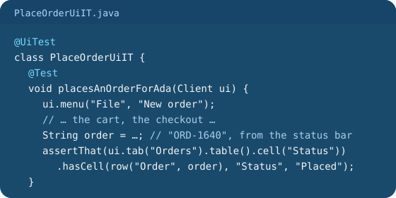
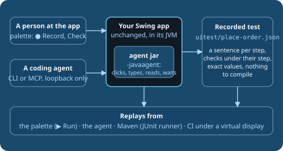

# Swing UI Agent

**Record UI tests for your real Swing application, and let a coding agent do the work.**

[](https://github.com/kormcrete/swing-ui-agent/actions/workflows/build.yml)
[](https://github.com/kormcrete/swing-ui-agent/actions/workflows/build.yml)
[](LICENSE)
[](https://github.com/kormcrete/swing-ui-agent/actions/workflows/build.yml)
[](https://github.com/kormcrete/swing-ui-agent/actions/workflows/build.yml)

AI-assisted testing of existing Java Swing desktop applications. Show the test in the app, or tell a coding agent in
words. You get a recorded test that replays from the app, the agent, Maven or CI. One jar attached to the app's JVM;
no changes to the app.



**Documentation: https://kormcrete.github.io/swing-ui-agent**

**For coding agents:** the docs as plain text, [llms.txt](https://kormcrete.github.io/swing-ui-agent/llms.txt) (an index)
or [llms-full.txt](https://kormcrete.github.io/swing-ui-agent/llms-full.txt) (all of them in one file).

## Try it in two minutes

[Order Desk](https://github.com/kormcrete/swing-order-desk-demo) is a small Swing order-entry app with the agent built
in, plus three recorded tests. Nothing to build.

1. **Download** it for
   [Mac with Apple Silicon](https://github.com/kormcrete/swing-order-desk-demo/releases/latest/download/kormcrete-order-desk-macos-arm64.dmg),
   [Mac with Intel](https://github.com/kormcrete/swing-order-desk-demo/releases/latest/download/kormcrete-order-desk-macos-x64.dmg),
   [Windows](https://github.com/kormcrete/swing-order-desk-demo/releases/latest/download/kormcrete-order-desk-windows-x64.zip)
   or [Linux and any Java 8+](https://github.com/kormcrete/swing-order-desk-demo/releases/latest/download/kormcrete-order-desk-java.zip),
   and open it ([first launch](https://kormcrete.github.io/swing-ui-agent/demo/tour/#download-and-run-it)).
2. **Run a recorded test:** press **Load recorded test…** in the bar at the bottom, pick `place-order`, press **▶ Run**.
   The app takes the order by itself and checks every total.
3. **Connect your agent** while the app runs, and ask it to place an order:

   ```sh
   claude mcp add --transport http order-desk http://127.0.0.1:8770/mcp
   ```

   *"Create a new order for Ada Shop Ltd with 3 packs of A4 paper and 10 black gel pens, check out, and tell me the
   order number."* Then ask it to save the steps as a recorded test.

More on the site: [Try it in two minutes](https://kormcrete.github.io/swing-ui-agent/#try-it-in-two-minutes),
[tour of Order Desk](https://kormcrete.github.io/swing-ui-agent/demo/tour/).

## What it does

It connects three things that usually happen apart:

- **A person shows** how the app should behave, in the app itself, or describes it in words.
- **A coding agent turns that** into a named, repeatable test.
- **Developers run the same test** locally and in CI, and move to an ordinary Java test when a check needs more.

<table>
<tr>
<td width="200" valign="top"><a href="site/src/assets/inspector/recording.png"></a></td>
<td valign="top">

**1. Records UI tests, from what you show or what you say.** Press **● Record** in the palette and use the app;
**Check** adds a check of what you see. Or tell a coding agent the test in words and it drives the live app. Either
way the agent names each step in plain words and saves a **recorded test**: a JSON file in `uitest/` with nothing to
compile. [Show it](https://kormcrete.github.io/swing-ui-agent/start/show/) ·
[Tell the agent](https://kormcrete.github.io/swing-ui-agent/start/record-together/)

</td>
</tr>
<tr>
<td width="200" valign="top"><a href="site/src/assets/inspector/steps.png"></a></td>
<td valign="top">

**2. Replays them, and lets you read and fix them.** The steps are sentences you can read, rename, replay from any
point or redo. Press **▶ Run** in the app, ask the agent, or run the whole `uitest/` folder from Maven and in CI under
a virtual display. A failing step says what it found.
[Run and edit a recorded test](https://kormcrete.github.io/swing-ui-agent/start/recorded-tests/) ·
[Run in CI](https://kormcrete.github.io/swing-ui-agent/start/ci/)

</td>
</tr>
<tr>
<td width="200" valign="top"><a href="site/src/assets/inspector/agent-asks.png"></a></td>
<td valign="top">

**3. Asks in the app when it is not sure.** When a step could mean two things, the agent boxes the candidates in the
app, numbered, and you confirm one or say none of these. The answer goes into the recording.
[Record together with your agent](https://kormcrete.github.io/swing-ui-agent/start/record-together/)

</td>
</tr>
<tr>
<td width="200" valign="top"><a href="site/src/assets/overview/java-test.svg"></a></td>
<td valign="top">

**4. Writes a Java test when you need more.** A recorded test holds exact values and checks what is on screen. When
a test must read a value that changes from run to run, such as the new order's number, or check a database, files or
logs, the agent writes a JUnit 5 `@UiTest` class instead, with the same driving API. The two kinds do not mix.
[Recorded tests or Java tests](https://kormcrete.github.io/swing-ui-agent/start/choose-test-kind/) ·
[One order, two files](https://kormcrete.github.io/swing-ui-agent/demo/two-files/)

</td>
</tr>
<tr>
<td width="200" valign="top"><a href="site/src/assets/overview/how-it-fits.svg"></a></td>
<td valign="top">

**5. Drives the real app, from a shell or over MCP.** One jar attached with `-javaagent:` clicks, types and reads the
live UI from inside the app's JVM. Input goes into the app's own event queue, so your mouse and keyboard stay yours. A
coding agent calls it one tool per step, from a shell (`java -jar … <tool>`) or over MCP on loopback; three skills in
[`skills/`](skills) teach it the workflow.
[Let your agent drive the app](https://kormcrete.github.io/swing-ui-agent/start/drive/) ·
[CLI or MCP](https://kormcrete.github.io/swing-ui-agent/agents/cli-or-mcp/) ·
[Skills](https://kormcrete.github.io/swing-ui-agent/agents/skills/)

</td>
</tr>
</table>

One step of Order Desk's `uitest/place-order.json`, with its check:

```json
{
  "action" : "answer",
  "say" : "Confirm the order",
  "button" : "Place order",
  "checks" : [
    {
      "say" : "The new order is Placed",
      "target" : { "role" : "label", "name" : "Placed" },
      "text" : "Placed"
    }
  ]
}
```

## Good to know

- **No changes to the app.** Add `-javaagent:`. Java 8 to 25, macOS, Linux and Windows.
- **Waits for the app, not a timer.** Every step lets the app settle; checks retry until they hold.
- **Finds what a person sees.** Labels, button text, column headers and cell text, not pixel positions.
- **Exact values, your data.** A recorded test checks what is on screen, such as the cart total `€31.32`. It creates
  the data it checks or uses data you know exists.
- **Local only.** It listens on `127.0.0.1`, refuses any other address, and no tool runs commands, loads a class or
  evaluates code. [Security](https://kormcrete.github.io/swing-ui-agent/agents/security/)
- **Your app's words (optional).** A small plugin adds reset, login and named steps such as "Add Gel pen, black to the
  cart". [Plugins](https://kormcrete.github.io/swing-ui-agent/plugins/what-a-plugin-adds/)
- **Early.** Expect changes before 1.0. A recorded test file carries its format version, and the agent refuses one it
  cannot read instead of guessing.
  [Recorded test format](https://kormcrete.github.io/swing-ui-agent/reference/recorded-test-format/)

## Use it on your app

Not on Maven Central yet: build and install it (JDK 8, Maven 3), then start your app with the agent.

```sh
mvn -B install -DskipTests
java -javaagent:target/swing-ui-agent-0.1.0-SNAPSHOT-agent.jar -jar my-app.jar
```

The palette appears in the app's main window and the agent listens on `127.0.0.1:8765`. Press **● Record**, or tell
your coding agent what to test.

- [Installation](https://kormcrete.github.io/swing-ui-agent/start/install/),
  [in IntelliJ](https://kormcrete.github.io/swing-ui-agent/start/intellij/),
  [with Claude Code](https://kormcrete.github.io/swing-ui-agent/start/claude-code/)
- [Record a test by showing it](https://kormcrete.github.io/swing-ui-agent/start/show/),
  [record together with your agent](https://kormcrete.github.io/swing-ui-agent/start/record-together/)
- [Recorded tests or Java tests](https://kormcrete.github.io/swing-ui-agent/start/choose-test-kind/),
  [run in CI](https://kormcrete.github.io/swing-ui-agent/start/ci/)
- [Skills](https://kormcrete.github.io/swing-ui-agent/agents/skills/) for your coding agent (in [`skills/`](skills)),
  the [tool reference](https://kormcrete.github.io/swing-ui-agent/reference/tools/)

## Status

Early, `0.1.0-SNAPSHOT`. CI runs every change on macOS (Java 8, 11, 17, 21, 25), Linux (Java 8, 25, under Xvfb) and
Windows (Java 8, 25), each with an end-to-end run of a real app. Linux and Windows are tested on CI runners and in
virtual machines, not yet on many real desktops. See [Limits](https://kormcrete.github.io/swing-ui-agent/project/limits/).

## Build

```sh
mvn -B verify
```

This builds the library and `swing-ui-agent-<version>-agent.jar`, the shaded agent used for `-javaagent:` and the
command line. To run the tests on another Java, keep building on JDK 8 and add `-Djvm=/path/to/jdk/bin/java`.

## License

Apache License 2.0. See [LICENSE](LICENSE) and [NOTICE](NOTICE).
