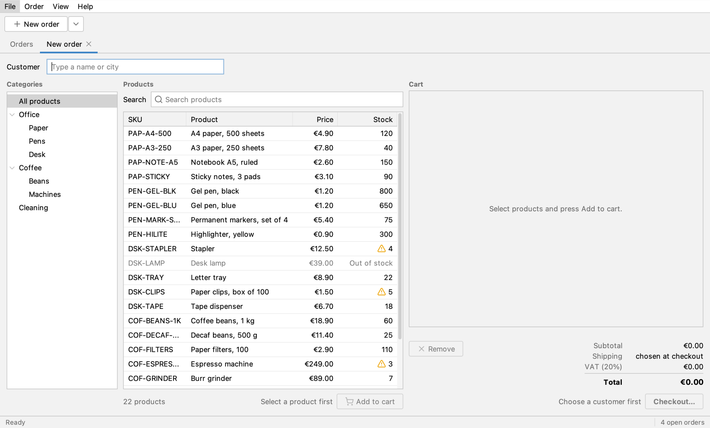
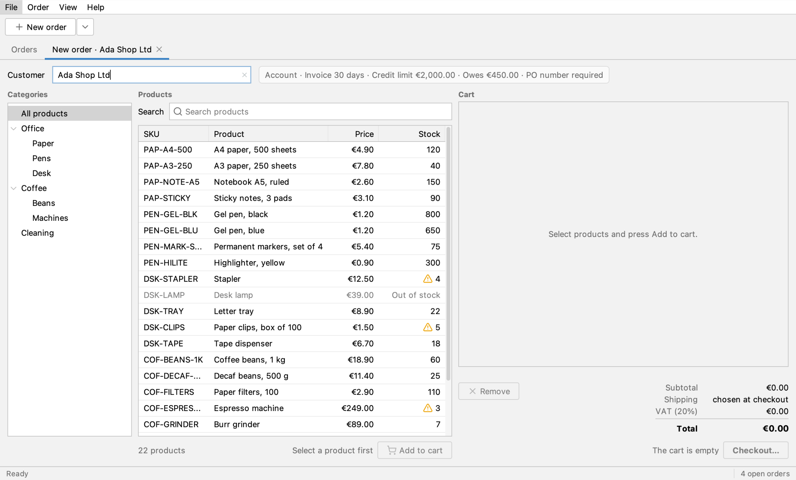
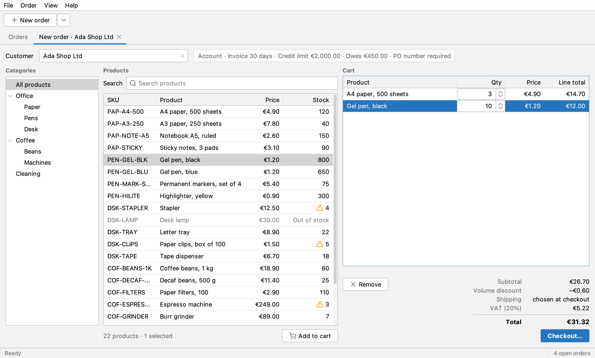
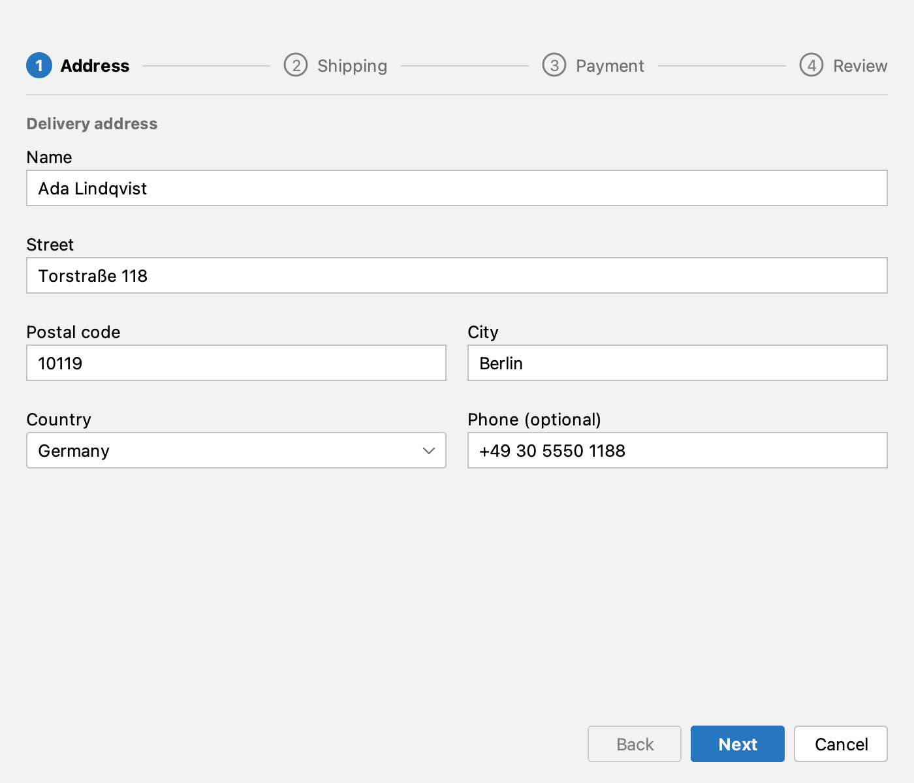
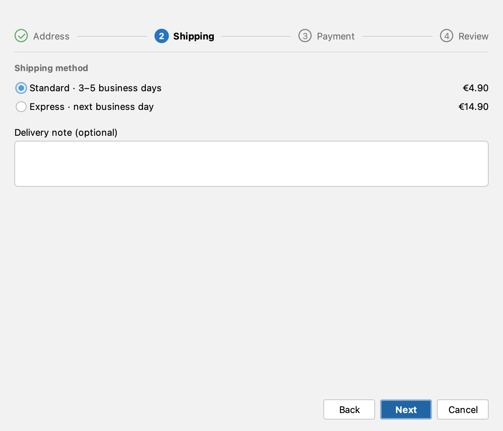
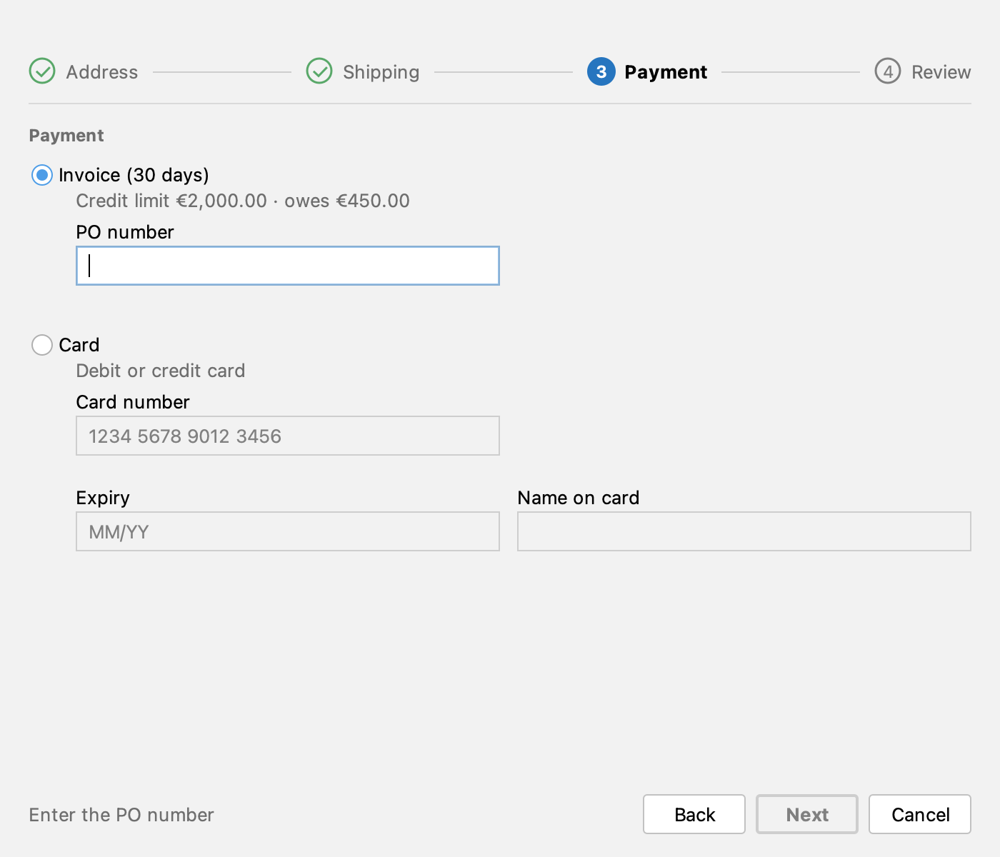
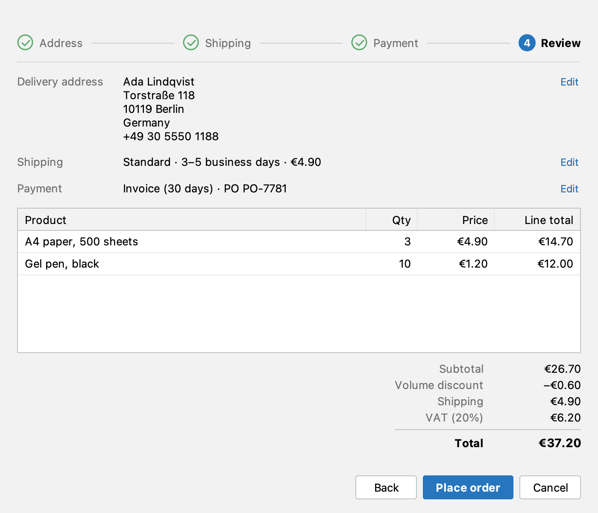
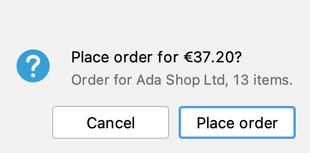
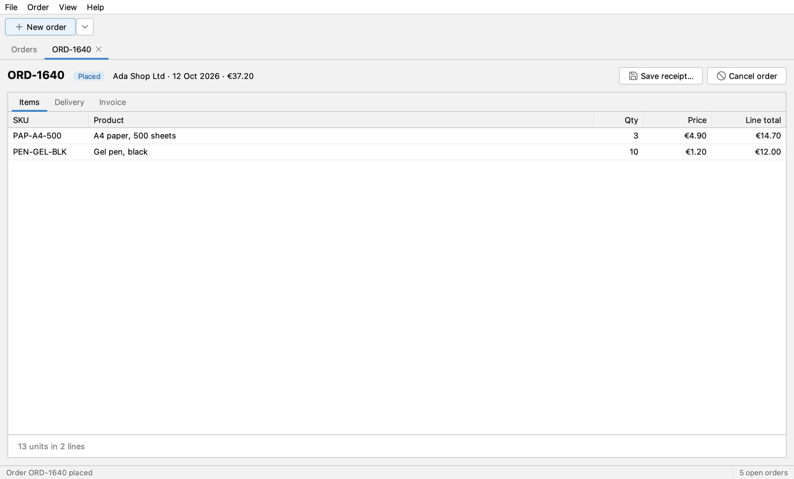
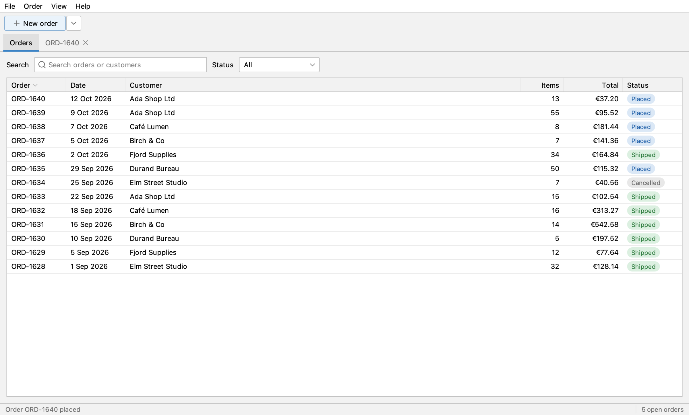

`PlaceOrderUiIT` places an order for Ada Shop Ltd, from File ▸ New order through the four checkout steps to the placed
order in the Orders table. A coding agent recorded it through the swing-ui-agent command line; a person reviewed it
and made three small edits. It takes a 2x screenshot after every step, and CI keeps them.

Source: [`PlaceOrderUiIT.java`](https://github.com/kormcrete/swing-order-desk-demo/blob/main/src/test/java/io/github/kormcrete/orderdesk/PlaceOrderUiIT.java)
in the Order Desk repository.

## How it was made

1. The agent started from `session reset`, so the recording began at a defined start.
2. It drove Order Desk through the CLI, one tool call per step: the menu, the Customer field, the products table,
   the cart, the checkout dialog. After each step it checked the result with `expect` and took a `screenshot` with
   scale 2.
3. `export_test` wrote the recording as a JUnit 5 class. Each recorded check became an `assertThat`, each screenshot
   a `saveScreenshot(…, 2)`.
4. A person reviewed the class like any other code. The review edits:
   - **The order number is read, not hard-coded.** The app gives each new order the next number, so the test reads it
     from the status bar ("Order ORD-1640 placed") with `UiAssertions.eventually`, until that order's tab is
     selected. A second run against the same app passes too.
   - **The account terms are matched with `contains`.** The label also shows what Ada owes, which grows with every
     order, so the check matches only the part before it.
   - **Long lines are wrapped** at 120 characters.

See [Record a test with the agent](/swing-ui-agent/start/record/) for the same workflow on your app.

## The test, step by step

The class is a plain JUnit 5 test. `@UiTest` connects it to the agent and hands it a `Client`:

<!-- snippet: src/test/java/io/github/kormcrete/orderdesk/PlaceOrderUiIT.java#L17-L21 -->
```java
@UiTest
class PlaceOrderUiIT {

    @Test
    void placesAnOrderForAda(Client ui) {
```

### 1. A new order

The test starts from wherever the app is, so it gets to its own starting screen through the menu bar.

<!-- snippet: src/test/java/io/github/kormcrete/orderdesk/PlaceOrderUiIT.java#L22-L25 -->
```java
ui.menu("File", "New order");

assertThat(ui.tab("New order")).isSelected();
ui.inWindow("main").saveScreenshot("PlaceOrderUiIT/01-new-order.png", 2);
```



### 2. The customer

It types "Ada" into the Customer field and presses Enter. The tab is renamed after the customer, and the account
terms appear.

<!-- snippet: src/test/java/io/github/kormcrete/orderdesk/PlaceOrderUiIT.java#L27-L33 -->
```java
ui.tab("New order").field("Customer").type("Ada");
ui.press("Enter");

assertThat(ui.tab("New order · Ada Shop Ltd")).isSelected();
assertThat(ui.tab("New order · Ada Shop Ltd")
        .label("Account · Invoice 30 days · Credit limit €2,000.00").contains()).isVisible();
ui.inWindow("main").saveScreenshot("PlaceOrderUiIT/02-customer.png", 2);
```



### 3. The cart

Two products go into the cart, found by their Product column. The quantities are typed into the spinner cells in the
Qty column. The checks read the totals as the cart shows them: subtotal, volume discount, VAT and total.

<!-- snippet: src/test/java/io/github/kormcrete/orderdesk/PlaceOrderUiIT.java#L35-L48 -->
```java
ui.tab("New order · Ada Shop Ltd").table().row("Product", "A4 paper, 500 sheets").cell("SKU").click();
ui.tab("New order · Ada Shop Ltd").button("Add to cart").click();
ui.tab("New order · Ada Shop Ltd").table().row("Product", "Gel pen, black").cell("SKU").click();
ui.tab("New order · Ada Shop Ltd").button("Add to cart").click();
ui.tab("New order · Ada Shop Ltd").table().row("Product", "A4 paper, 500 sheets").cell("Qty")
        .type("3", null, Boolean.TRUE);
ui.tab("New order · Ada Shop Ltd").table().row("Product", "Gel pen, black").cell("Qty")
        .type("10", null, Boolean.TRUE);

assertThat(ui.tab("New order · Ada Shop Ltd").label("€26.70")).isVisible();
assertThat(ui.tab("New order · Ada Shop Ltd").label("−€0.60")).isVisible();
assertThat(ui.tab("New order · Ada Shop Ltd").label("€5.22")).isVisible();
assertThat(ui.tab("New order · Ada Shop Ltd").label("€31.32")).isVisible();
ui.inWindow("main").saveScreenshot("PlaceOrderUiIT/03-cart.png", 2);
```



### 4. Address

**Checkout…** opens the checkout dialog. The address comes from Ada's account; the test checks the postal code and
takes a screenshot of the dialog only.

<!-- snippet: src/test/java/io/github/kormcrete/orderdesk/PlaceOrderUiIT.java#L50-L53 -->
```java
ui.tab("New order · Ada Shop Ltd").button("Checkout…").click();

assertThat(ui.dialog().field("Postal code")).hasValue("10119");
ui.inWindow("dialog").saveScreenshot("PlaceOrderUiIT/04-address.png", 2);
```



### 5. Shipping

<!-- snippet: src/test/java/io/github/kormcrete/orderdesk/PlaceOrderUiIT.java#L55-L58 -->
```java
ui.dialog().button("Next").click();

assertThat(ui.dialog().radio("Standard · 3–5 business days")).isChecked();
ui.inWindow("dialog").saveScreenshot("PlaceOrderUiIT/05-shipping.png", 2);
```



### 6. Payment

Ada pays on invoice and needs a PO number. Until there is one, the dialog says so and Next is disabled: the test
checks both.

<!-- snippet: src/test/java/io/github/kormcrete/orderdesk/PlaceOrderUiIT.java#L60-L64 -->
```java
ui.dialog().button("Next").click();

assertThat(ui.dialog().label("Enter the PO number")).isVisible();
assertThat(ui.dialog().button("Next")).isDisabled();
ui.inWindow("dialog").saveScreenshot("PlaceOrderUiIT/06-payment.png", 2);
```



### 7. Review

<!-- snippet: src/test/java/io/github/kormcrete/orderdesk/PlaceOrderUiIT.java#L66-L70 -->
```java
ui.dialog().field("PO number").type("PO-7781");
ui.dialog().button("Next").click();

assertThat(ui.dialog().label("€37.20")).isVisible();
ui.inWindow("dialog").saveScreenshot("PlaceOrderUiIT/07-review.png", 2);
```



### 8. Confirm

**Place order** asks to confirm. The test takes a screenshot of the question, then answers it with its
**Place order** button.

<!-- snippet: src/test/java/io/github/kormcrete/orderdesk/PlaceOrderUiIT.java#L72-L74 -->
```java
ui.dialog().button("Place order").click();
ui.inWindow("dialog").saveScreenshot("PlaceOrderUiIT/08-confirm.png", 2);
ui.answer("Place order");
```



### 9. The placed order

The order is placed in the background, then its tab opens. This is the first review edit: the test reads the new
order number from the status bar and waits until that order's tab is selected.

<!-- snippet: src/test/java/io/github/kormcrete/orderdesk/PlaceOrderUiIT.java#L76-L84 -->
```java
// the number is the app's next one: wait for the status bar to name the order whose tab is selected, so a
// rerun against a running app passes too (the last run's "Order … placed" shows until this one replaces it)
String order = eventually("the status bar naming the new order", Duration.ofMillis(8000L), () -> {
    String placed = ui.main().label("placed").contains().text();   // "Order ORD-1640 placed"
    String number = placed.substring("Order ".length(), placed.indexOf(" placed"));
    return ui.tab(number).states().contains("selected") ? number : null;
}, number -> number != null);
assertThat(ui.tab(order)).isSelected();
ui.inWindow("main").saveScreenshot("PlaceOrderUiIT/09-placed.png", 2);
```



### 10. In the Orders table

Back on the Orders tab, the new order is listed as Placed with its total.

<!-- snippet: src/test/java/io/github/kormcrete/orderdesk/PlaceOrderUiIT.java#L86-L90 -->
```java
ui.tab("Orders").click();

assertThat(ui.tab("Orders").table().cell("Status")).hasCell(row("Order", order), "Status", "Placed");
assertThat(ui.tab("Orders").table().cell("Status")).hasCell(row("Order", order), "Total", "€37.20");
ui.inWindow("main").saveScreenshot("PlaceOrderUiIT/10-orders-after.png", 2);
```



## Run it

- **By hand:** start Order Desk with the agent on port 8770, then `mvn -B -Pui verify`, as in
  [Run the tests](/swing-ui-agent/start/run/), or from IntelliJ as in
  [Record and run a UI test in IntelliJ](/swing-ui-agent/start/intellij/). The screenshots land in
  `target/ui-screenshots/PlaceOrderUiIT/`, `01-new-order.png` to `10-orders-after.png`.
- **In CI:** the Order Desk [build workflow](https://github.com/kormcrete/swing-order-desk-demo/blob/main/.github/workflows/build.yml)
  runs it on every push, on Linux with Java 8, and keeps the `ui-screenshots` artifact. See
  [Run in CI](/swing-ui-agent/start/ci/).

Each run places a real order on invoice, so Ada owes €37.20 more after it. Her credit limit is €2,000.00: restart
Order Desk before about 40 runs, or the credit limit warning appears and the test fails.

## What's next

- [Tour of Order Desk](/swing-ui-agent/demo/tour/): more tests to record.
- [Record a test with the agent](/swing-ui-agent/start/record/) and [Run the tests](/swing-ui-agent/start/run/) on your own app.
