Order Desk is a small Swing app where a shop employee takes an order for a customer: pick the customer, add products
to the cart, check out and place the order. It is the app every example on this site drives. It has the parts real
Swing business apps have, so a coding agent has real work to do. All customers, products and orders are invented, and
everything lives in memory: each start begins with the same data.

Source: [kormcrete/swing-order-desk-demo](https://github.com/kormcrete/swing-order-desk-demo) (Java 8, FlatLaf,
MigLayout, Apache-2.0).


## Download and run it

Order Desk is published ready to run, with the agent built in: it starts with the agent on port 8770. The Mac and
Windows downloads include Java (Zulu JRE 8); the Java zip runs on your own Java 8 or newer, on any computer (Linux
too).

| Your computer | Download |
|---|---|
| Mac with Apple Silicon (M1 and later) | [kormcrete-order-desk-macos-arm64.dmg](https://github.com/kormcrete/swing-order-desk-demo/releases/latest/download/kormcrete-order-desk-macos-arm64.dmg) |
| Mac with Intel | [kormcrete-order-desk-macos-x64.dmg](https://github.com/kormcrete/swing-order-desk-demo/releases/latest/download/kormcrete-order-desk-macos-x64.dmg) |
| Windows (x64) | [kormcrete-order-desk-windows-x64.zip](https://github.com/kormcrete/swing-order-desk-demo/releases/latest/download/kormcrete-order-desk-windows-x64.zip) |
| Linux, or any computer with Java 8 or newer | [kormcrete-order-desk-java.zip](https://github.com/kormcrete/swing-order-desk-demo/releases/latest/download/kormcrete-order-desk-java.zip) |

The downloads are not signed yet, so the first launch takes one extra step:

- **macOS:** open the `.dmg` and drag **Kormcrete Order Desk** to Applications. The app is not notarized by Apple yet,
  so macOS refuses to open it ("Apple could not verify…"). Clear the download mark once, in Terminal, then open it:

  ```bash
  xattr -dr com.apple.quarantine "/Applications/Kormcrete Order Desk.app"
  ```

- **Windows:** unzip, open the **Kormcrete Order Desk** folder and run **Kormcrete Order Desk.exe**. If SmartScreen
  stops it, click **More info → Run anyway**.
- **Java zip:** unzip, then run `order-desk` in the **Kormcrete Order Desk** folder (`order-desk.cmd` on Windows). It
  uses `JAVA_HOME` when set, else the `java` on your PATH, and prints the agent's lines in the terminal.

Then connect your coding agent while the app runs:

```bash
claude mcp add --transport http order-desk http://127.0.0.1:8770/mcp
```

Other clients: [MCP clients](/swing-ui-agent/agents/mcp-clients/). If your agent cannot connect, another app may be
using port 8770; the agent's log says so: `~/Library/Logs/Kormcrete Order Desk/agent.log` (macOS),
`%LOCALAPPDATA%\Kormcrete Order Desk\agent.log` (Windows), the terminal (Java zip). All releases:
[swing-order-desk-demo releases](https://github.com/kormcrete/swing-order-desk-demo/releases).

## Build it from source

To record tests into the project, or change the app, build it yourself. swing-ui-agent is not on Maven Central yet, so
you build both projects.

1. Clone both repositories side by side and install swing-ui-agent:

   ```bash
   git clone https://github.com/kormcrete/swing-ui-agent.git
   git clone https://github.com/kormcrete/swing-order-desk-demo.git
   (cd swing-ui-agent && mvn -B install -DskipTests)
   ```

2. Build Order Desk. This writes `target/order-desk.jar` and copies the agent jar to
   `target/swing-ui-agent-agent.jar`:

   ```bash
   cd swing-order-desk-demo
   mvn -B package
   ```

3. Start it with the agent:

   ```bash
   java -javaagent:target/swing-ui-agent-agent.jar=port=8770 \
        -Dorderdesk.today=2026-10-12 -jar target/order-desk.jar
   ```

   - `-javaagent:…` lets a coding agent drive the app on port 8770. Without it Order Desk is a normal app.
   - `-Dorderdesk.today=2026-10-12` fixes the date used for new orders and the card expiry check, so every run looks
     the same. Leave it out to use today's date.

4. Check that the agent answers:

   ```bash
   java -jar target/swing-ui-agent-agent.jar --port 8770 session
   ```

## The screens

### Orders

The first tab lists the orders, newest first. Search by order number or customer, filter by status (All, Placed,
Shipped, Cancelled), sort by any column, and right-click an order to open it, copy its number or cancel it. Only placed
orders can be cancelled.

### New order

**New order** (or File ▸ New order) opens a New order tab. The ▾ next to it starts one for a recent customer. Type in
the Customer field to pick a customer from its popup; the account terms appear next to it. Pick a category in the
tree, select products and press **Add to cart**. In the cart, the Qty cells are spinners, and the totals update as you
go: 10 or more of one product take 5% off that line.

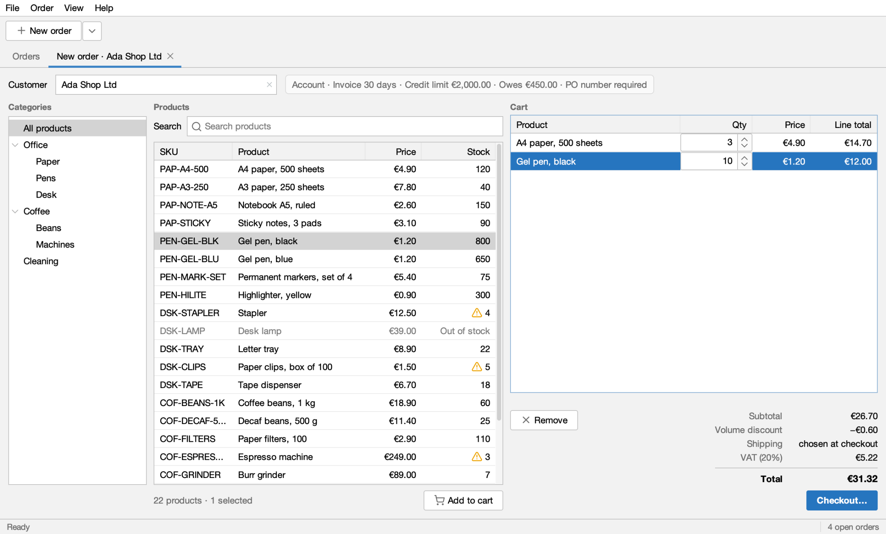

### Checkout

**Checkout…** opens a modal dialog with four steps: Address, Shipping, Payment and Review. Next stays disabled while
a step is not complete, and the reason is shown next to it.

**Address:** the customer's address on file, editable.

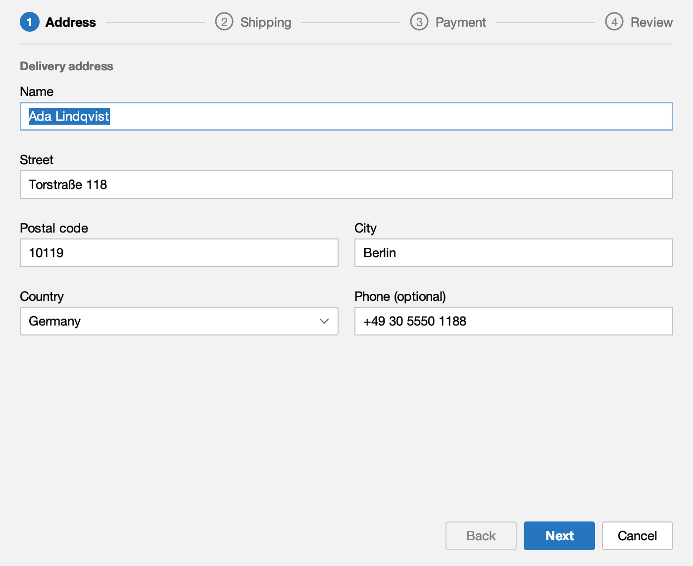

**Shipping:** Standard or Express, and a delivery note.

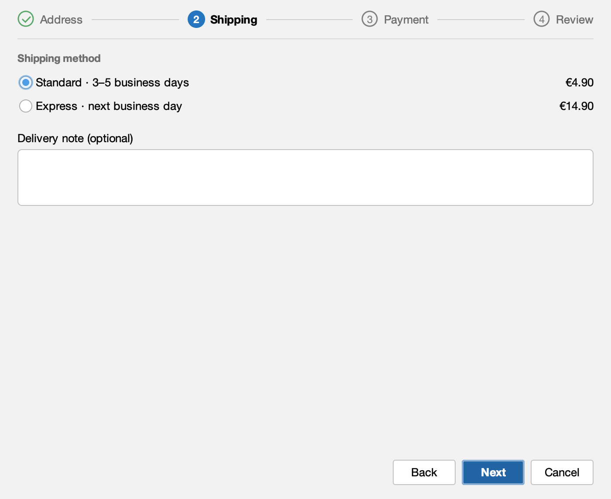

**Payment:** invoice with a PO number, or card.

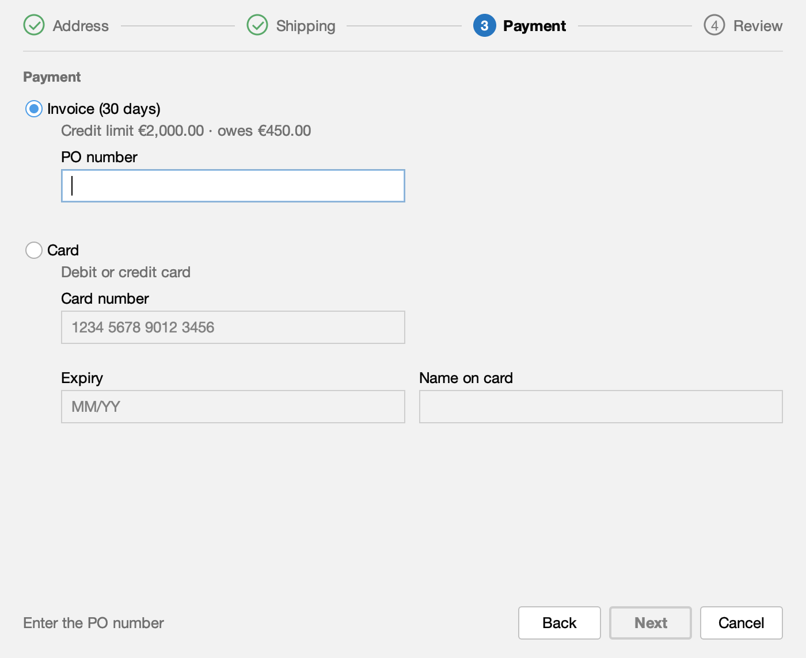

**Review:** everything once more, with Edit links.

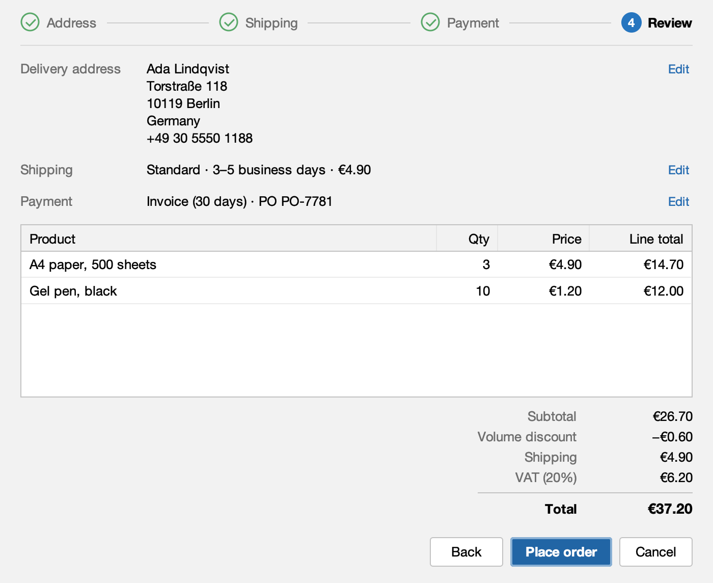

**Place order** asks to confirm, then places the order in the background ("Placing order…") and opens the new
order's tab.

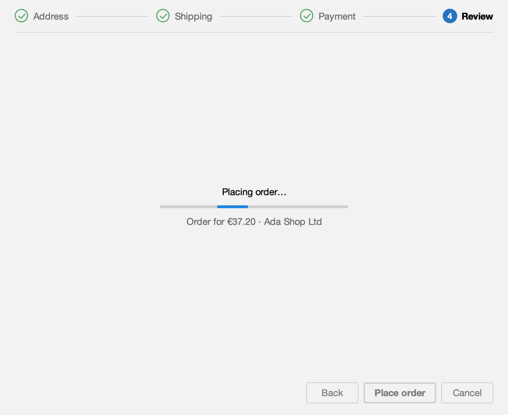

### The rules

Each customer runs into a different rule, so there is always something to check.

- **Credit limit:** an invoice order that takes a customer over their limit asks first. Birch & Co with an Espresso
  machine shows it.

  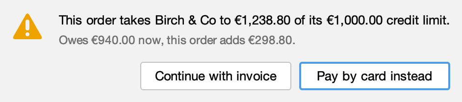

- **Address errors:** Elm Street Studio has no postal code on file, so the field is marked in red and Next stays
  disabled until it is filled in.

  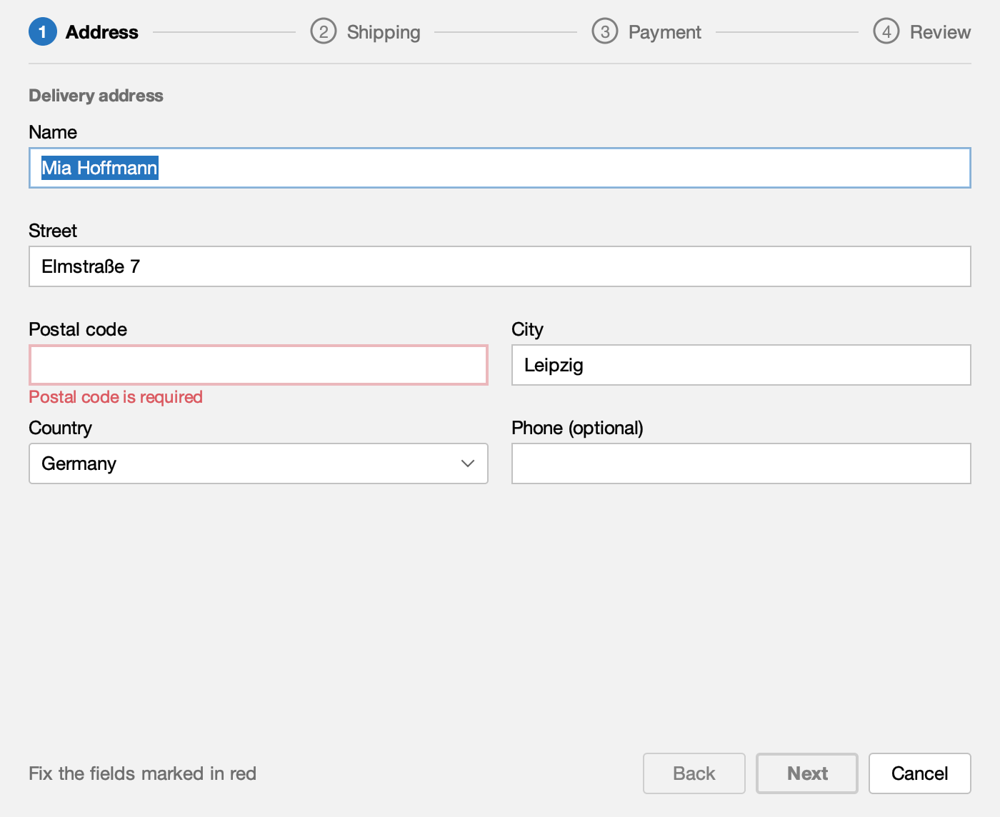

- **Express:** it delivers to Germany and Austria only, so Café Lumen in Amsterdam cannot pick it.

  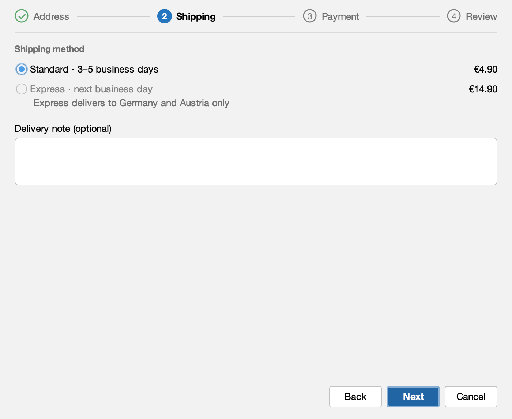

- **Card only:** Café Lumen, Durand Bureau and Fjord Supplies pay by card, so there is no invoice choice.

  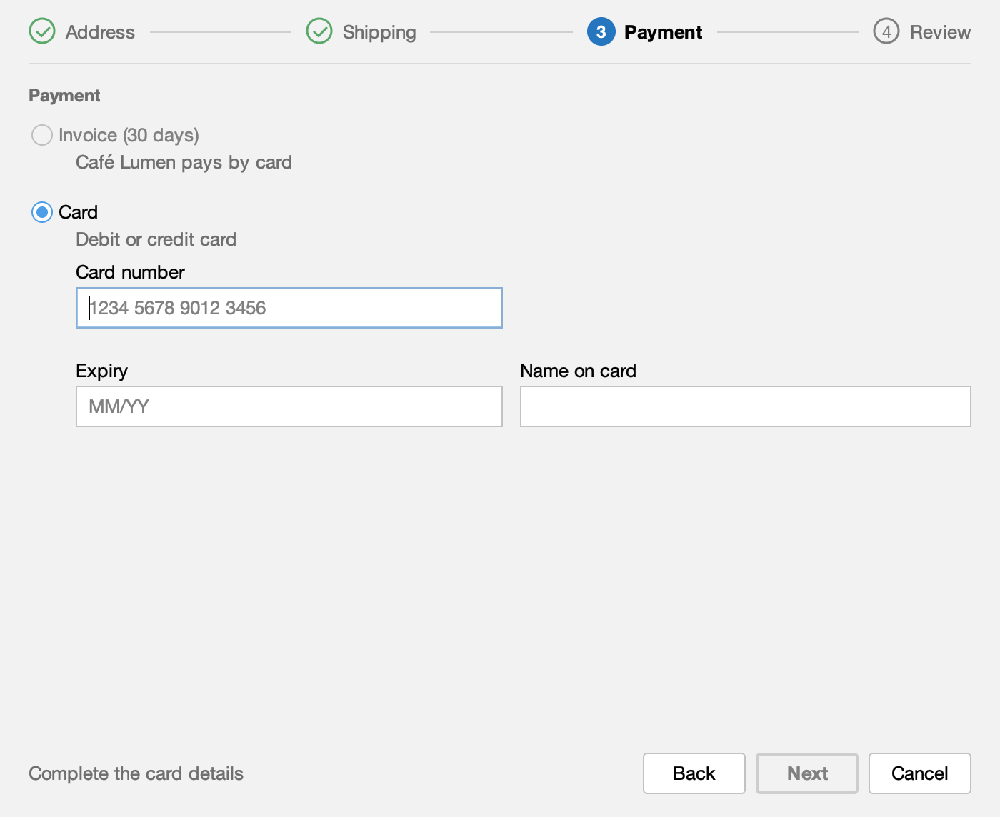

- **Stock:** a cart line that asks for more than is in stock is outlined in red and Checkout… stays disabled. The Desk
  lamp is out of stock and cannot be added.

  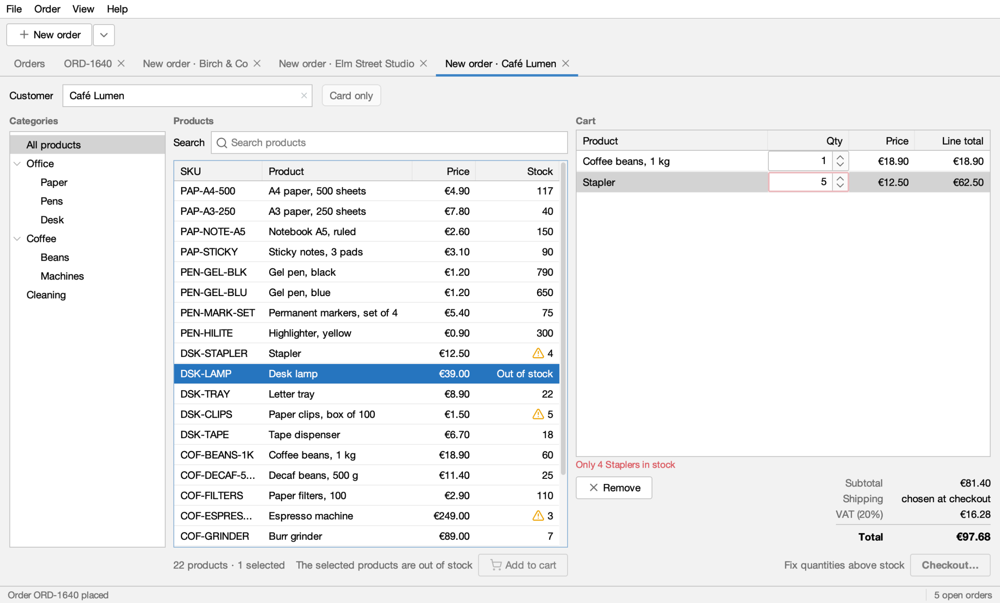

### An order's tab

A placed order opens in its own tab: number, status, its key facts, **Save receipt…**, **Cancel order**, and Items, Delivery
and Invoice tabs. Save receipt… writes a plain-text receipt through a file chooser.

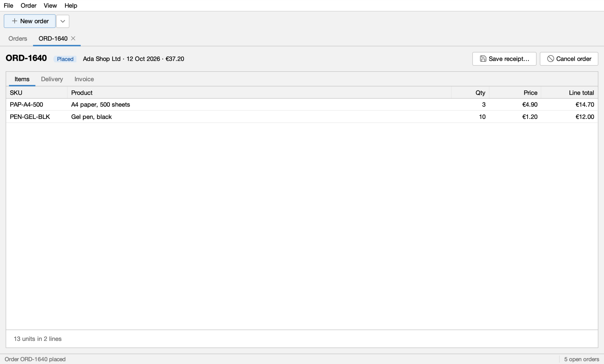

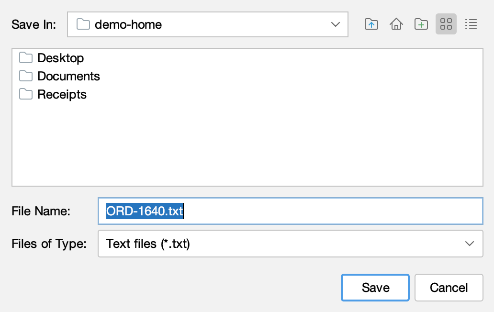

### Closing and themes

- File ▸ Close tab, ⌘W (Ctrl+W elsewhere) and File ▸ Exit ask first while a New order tab has products in its cart.
- View ▸ Theme switches between Light and Dark.

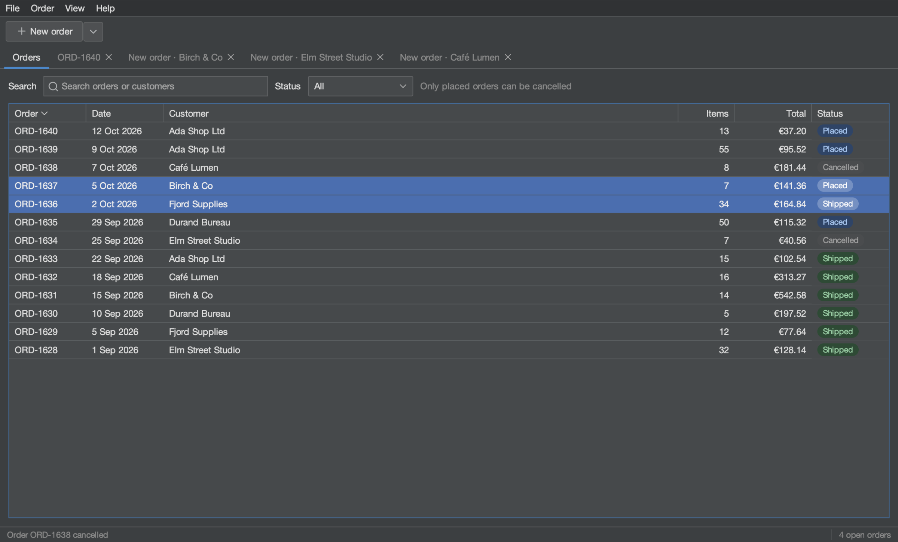

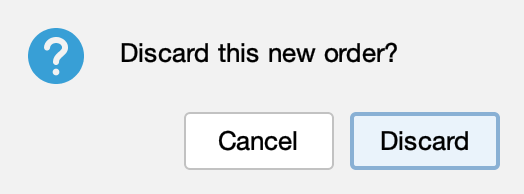

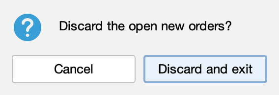

## The Swing parts it has

Each part has a guide that shows how the agent and the tests handle it:

- Closable tabs, labels, buttons and text fields: [Targets and locators](/swing-ui-agent/guides/targets/)
- Sortable, filtered tables, and cart cells edited with a spinner: [Tables](/swing-ui-agent/guides/tables/)
- The category tree: [Trees](/swing-ui-agent/guides/trees/)
- The menu bar with accelerators, the ▾ menu next to New order, the Customer field's popup and right-click menus:
  [Menus and popups](/swing-ui-agent/guides/menus/)
- The checkout wizard, confirm dialogs and the file chooser:
  [Dialogs and file choosers](/swing-ui-agent/guides/dialogs/)
- Placing an order in the background, and buttons that enable when a rule is met:
  [Waiting](/swing-ui-agent/guides/waiting/)
- Light and dark themes, and screenshots of a window or a dialog: [Screenshots](/swing-ui-agent/guides/screenshots/)

## Things to try

Ask your agent to do one of these, or [record it as a test](/swing-ui-agent/start/record-together/):

- ▾ next to New order, then Ada Shop Ltd: a New order tab with Ada's account terms next to the Customer field.
- Add 3 × A4 paper and 10 × Gel pen, black: the 5% volume discount appears and the cart total is €31.32.
- Checkout… with Standard shipping and a PO number: the review shows €37.20, and Place order makes order ORD-1640.
- Birch & Co with an Espresso machine on invoice: the credit limit warning, then Pay by card instead.
- Elm Street Studio at checkout: the postal code is missing, so Next stays disabled until it is filled in.
- Café Lumen at checkout: no Express to the Netherlands, and Café Lumen pays by card only.
- 5 Staplers when 4 are in stock: the cart says so and Checkout… stays disabled; the Desk lamp cannot be added.
- The Orders tab: search for "birch", filter by status, right-click an order to cancel it.
- An order's tab: Save receipt… writes a plain-text receipt through a file chooser.
- File ▸ Close tab, ⌘W (Ctrl+W elsewhere) and File ▸ Exit, which ask first while a cart has products.
- View ▸ Theme ▸ Dark and back.

## What's next

- [PlaceOrderUiIT, step by step](/swing-ui-agent/demo/recorded-test/): a test the agent recorded on Order Desk.
- [Let your agent drive the app](/swing-ui-agent/start/drive/)
- [Record a test with the agent](/swing-ui-agent/start/record/)
- [Record together with your agent](/swing-ui-agent/start/record-together/)
- [Recorded tests or Java tests](/swing-ui-agent/start/choose-test-kind/)
