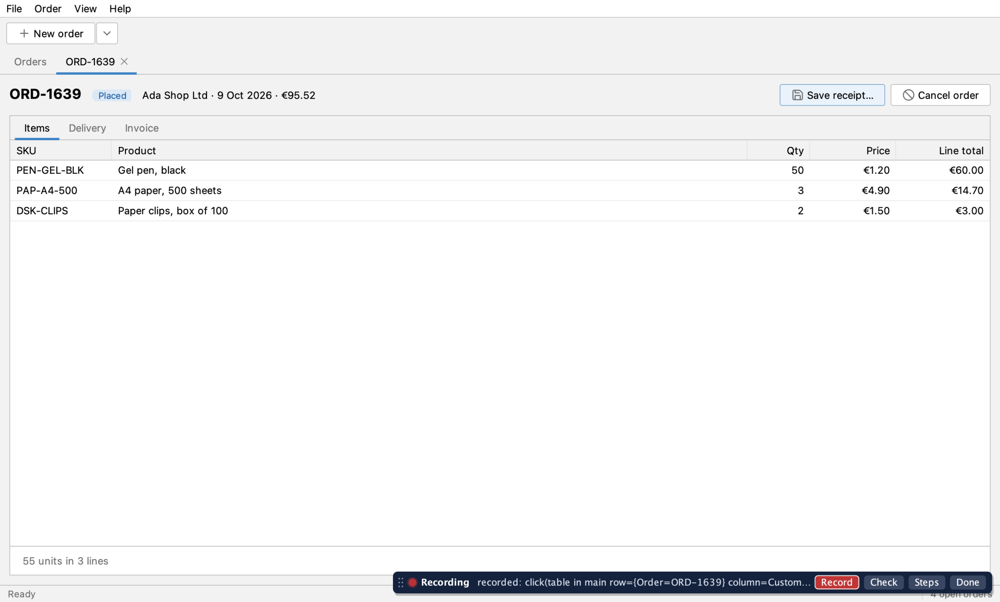
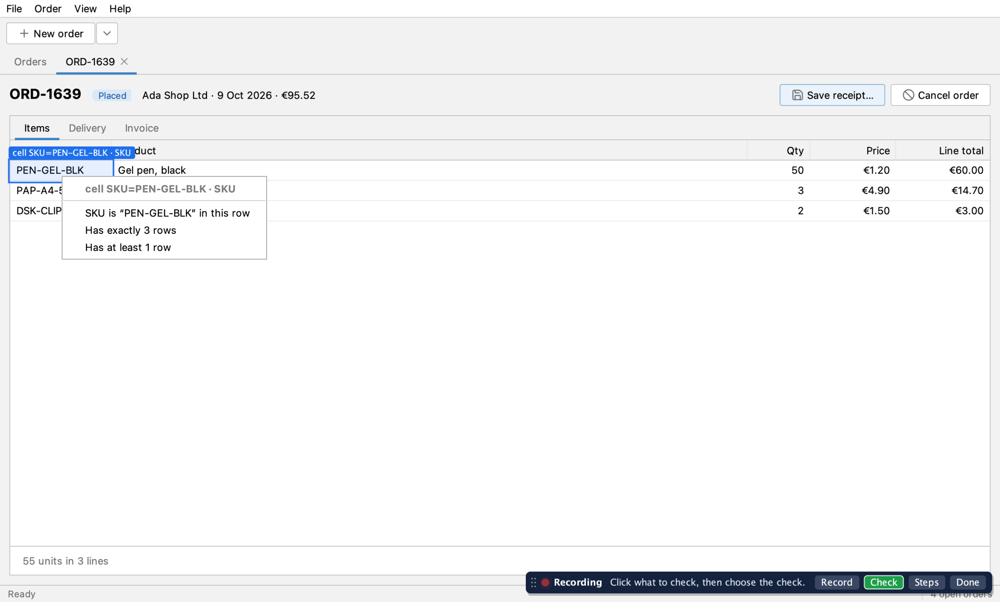
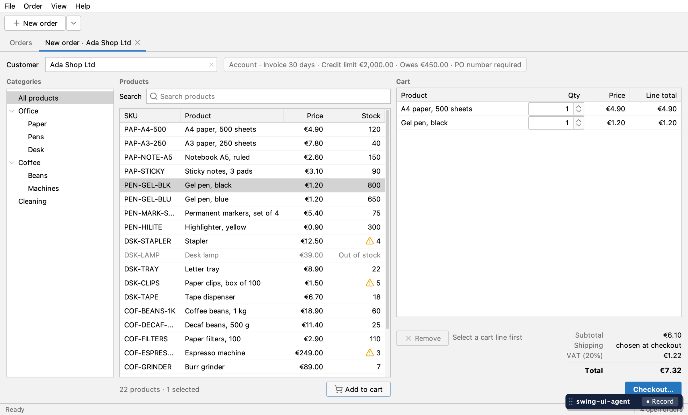
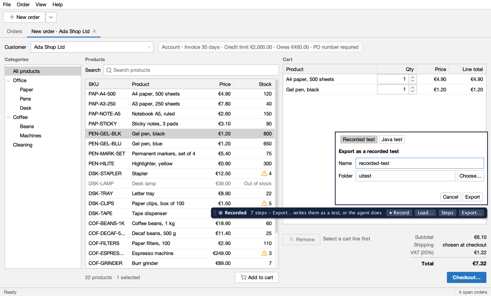
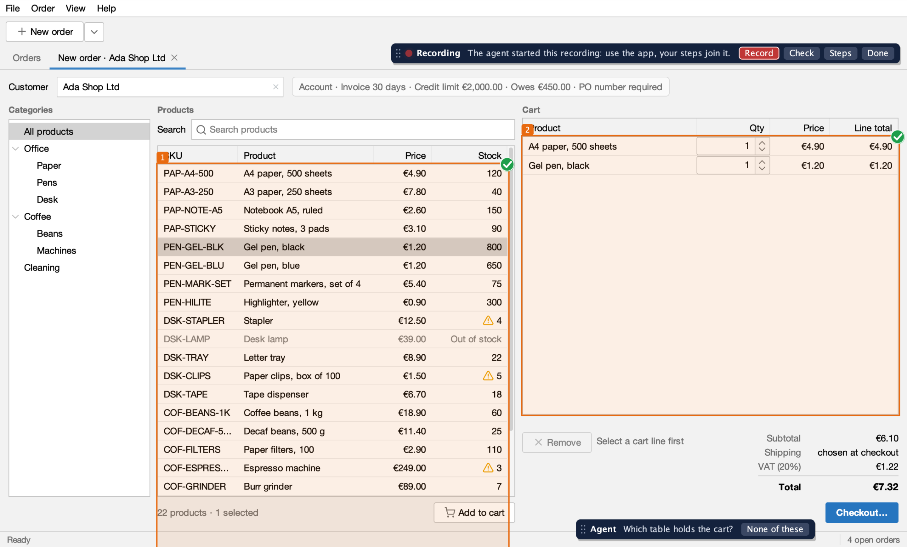

Sometimes it is quicker to show the agent what a test should do than to describe it. Start the app with
the agent and a small palette appears in its window. You press **● Record** and use the app. Every click,
selection and bit of typing becomes a step, as if the agent had run it. **Check** adds checks, **Steps** lets you
replay and fix them, and **Done** ends the recording. Then **Export…** writes the test, or your coding agent does.
Later, **Load recorded test…** opens it again to run, watch step by step, fix and save back.

This is the path for people showing the app. For when a recorded test is the right kind, and when a Java test is, see
[Recorded tests or Java tests](/swing-ui-agent/start/choose-test-kind/). To record with your agent doing the clicking
from your words, see [Record together with your agent](/swing-ui-agent/start/record-together/).



You will learn how to:

- start the app with the palette;
- record steps and checks;
- replay, redo and delete steps, and name them;
- export the test, yourself or through the agent;
- load it again, run it and save your changes back;
- answer the agent when it asks about the app.

## Before you start

- Your coding agent can call the CLI and has the [skills](/swing-ui-agent/agents/skills/) installed. The
  `swing-ui-record-test` skill knows this workflow.
- You are at the screen. The palette is for a person working with the agent.

## 1. Start the app with the agent

Start the app as in [Installation](/swing-ui-agent/start/install/). The palette is on by default, so there is nothing
to add. It appears at the bottom right of the main window about a second after the window shows. Drag it by its grip
if it covers something you need. It is part of the window, not a separate one, so it also works when the app is full
screen.

- `palette=off` turns it off, for agent-only runs, CI and shared machines: no palette, and nothing listens to input.
- `mode=background` turns it off too, and `palette=on` with it is refused: the palette needs the app in front of you.
  A headless run has no palette either.
- `session` shows `"palette": true`, which is how the agent knows it can ask you.

## 2. Record the steps

Get to the screen where the test should start, then press **● Record**. A red pulsing dot and the word
**Recording** show that it is on. Your agent can start a recording too (`recording {"op":"start"}`); the palette
shows it at once.

Use the app as you normally would:

- **Clicks and double clicks** are recorded on the element you click.
- **Check boxes and toggle buttons** become a `check` step with the state they end in.
- **Typing** is recorded when you leave the field or press Enter, and only when you typed: text the app filled in is
  not a step.
- **Combo box items** become a `select` step.
- **Menus**, from the menu bar or the macOS screen menu bar, and their shortcuts, become a `menu` step.
- **Context menus** become a `context_menu` step.
- **Key chords** such as Escape or ⌘W become a `press` step.

Make the first step one that gets to the test's starting screen from anywhere, such as **File ▸ New order** (see
[Reset and the starting screen](/swing-ui-agent/guides/reset/)). When the first step is a click instead, the export
comes back with a `startWarning`.

## 3. Add checks

Press **Check**. The bar says "Click what to check · Esc or ◀ to go back." Clicks now go to the palette, not to the
app. Click an element and pick a check built from what it shows right now. The menu's first line, greyed, names what
you clicked in words from the screen; the lines below are the checks.

A value check reads the value together with its caption. In the cart, click the **Total** label: the menu offers
**Reads “€31.32”** for 3 A4 paper and 10 Gel pen. Choose it and the recording gets a check on **Total** that expects
exactly `€31.32` (it shows in the list as, for example, `4.1`: step 4, check 1).

<!-- TODO picture (Task 12): Check mode on the cart's Total label, boxed, with the menu title Total and the line Reads “€31.32” -->



Which checks you get depends on the element. For example:

- **Labels and buttons:** Reads “…” (a button only when it has text), then Is enabled or Is disabled.
- **Text fields:** Value is “…”, or Is empty; Is editable or Is read-only.
- **Drop-downs:** Shows “…”, and the row counts below.
- **Check boxes and toggle buttons:** Is checked, Is not checked.
- **Tabs:** Is the open tab, or Is not the open tab.
- **Table cells:** the column and the value, for example Product is “Gel pen, black” in this row; This row is selected
  when it is; Has exactly N rows; Has at least 1 row.
- **Any control with a tooltip:** Its tooltip is “…”.

Column checks such as "Every row's Status is …" and "Sorted by …" are greyed out, marked "(expect cannot check this
yet)".

Each check runs as soon as you choose it. A check that passes is added to the recording, and a green ✓ flashes on
the element. One that fails is not added: a red ✗ flashes there and the bar says "✗ not recorded". You stay in Check
mode until you press **◀ Back to recording** (the Record button while you check) or Esc. That Esc never reaches the app.

## 4. Replay and fix the steps

Press **Steps** to open the list of what has been recorded so far, your steps and checks and any the agent ran.



- **▶ Replay all** and **▶ From selected** run the steps again in the app. Choose the **Replay speed** first:
  Fast, Normal, Slow or Step by step.
- **Step by step** stops before each step: press **Next** to run it. An action and the checks that follow it run as
  one step. **Pause**, **Resume** and **Stop** work at every speed.
- **↺ Redo from selected** drops that step and everything after it, replays the steps before it, and records again
  from there.
- **✕ Delete** removes one step with its checks, or one check. **↶ Undo** takes back the last edit, yours or the
  agent's.
- **Double-click a row** (or select it and press F2 or Enter) to describe a step or a check in a sentence of your
  own, right in the list: Enter saves, Esc cancels. Select several steps first to give them one sentence as a group;
  double-click a group's header to rename it. **⋯** (or a right click on a row) offers the same as **Describe…**.

Results stay on the steps as ✓ and ✗ until the next replay. **Replay all** and a redo begin with a reset, as the test
will; without a plugin that only closes dialogs, so the first step has to get to the starting screen.

### Name the steps

Select a row in the Steps list and double click it, or press F2 or Enter, to give it a sentence; **⋯** or a right
click opens the same as **Describe this step…**, **Describe this check…** or **Describe these steps…**. All the ways,
groups and how a table row is kept are in [Sentences and groups](/swing-ui-agent/guides/sentences/).

<!-- TODO picture (Task 12): the Steps list with the row menu open: Describe this step…, Ungroup, Row: this value, Row: by position -->

## 5. Press Done, then export

Press **Done** when the steps are right. The bar shows **Recorded** and offers:

- **● Record:** a new recording, which replaces this one.
- **Load…:** a recorded test file instead of this recording, to run or fix; see [step 6](#6-load-it-again-run-it-save-back).
- **Steps:** this recording, to replay or fix.
- **Export…:** writes the recording as a recorded test file or a Java test, without an agent.

**Export it yourself.** Press **Export…**. It opens on **Recorded test** (a name and a folder); choose **Java test**
for a class name ending in `UiIT` and a package, filled in with the app's own. The next Export… opens on the kind you
chose last. Press **Export**. The palette says where
the file went, and when the first step does not get the app to a known screen it says that too. The recording stays,
so you can still fix it and export again under another name. An existing file is never overwritten.



**Or let the agent export it.** When your agent is waiting for you, Done hands it the recording. It exports the
test, runs it from another screen and fixes the locators it flags, as in
[Record a test with the agent](/swing-ui-agent/start/record/):

```sh
UI="java -jar target/swing-ui-agent-agent.jar --port 8770"
$UI recording '{"op":"list","wait":540000}'          # returns at your Done: state stopped, with the steps
$UI export_test '{"class":"NewOrderForAdaUiIT","package":"io.github.kormcrete.orderdesk"}'
```

Either way, run the new test once from another screen before you commit it. See
[Record and run a UI test in IntelliJ](/swing-ui-agent/start/intellij/) for that loop in the IDE.

## 6. Load it again, run it, save back

A recorded test is a file you can open again in a new session. Press **Load recorded test…** (or **Load…** after
Done), choose the file, then **▶ Run**, with **Step by step** if you want to watch. The steps are the same Steps list
as when recording, so you can name, delete or redo them. **Export…** reads **Save** under the test's own name and writes
over it; under another name it reads **Export** and writes a new file. The full walk-through is in
[Run and edit a recorded test](/swing-ui-agent/start/recorded-tests/#open-one-in-the-palette).

While you run, the agent's calls are refused with BUSY and a message such as "a person is running gel-pen-total in
the app" (or "a person is replaying their recording in the app").

<!-- TODO picture (Task 12): the Loaded bar with the Steps panel showing ▶ Run and the Replay speed on Step by step -->

## Answer the agent in the app

With the palette on, the agent can ask you about the app in the app itself instead of guessing:

- **Highlight:** the agent boxes everything a locator matches, numbered when there are several, and asks a question
  on a bar. You click the ✓ on the one you mean, or **None of these**. The agent gets the locator of your choice.
- **Pick:** the agent asks you to click what you mean. The click goes to the palette, not the app, and the agent gets
  a locator for it.



```sh
$UI inspect '{"op":"highlight","target":{"role":"table"},"question":"Which table holds the cart?"}'
$UI inspect '{"op":"pick","question":"Click the field that holds the customer"}'
```

`inspect` also has `hover`, which names what is under your pointer as you move it, and `clear`, which removes
the agent's boxes and question.

## You and test runs

While you record, pick, answer or replay, a test run cannot take the agent. While a test run holds it, the palette
leaves the window. `session reset` is refused while you record. See
[Leases and several clients](/swing-ui-agent/guides/leases/#a-person-at-the-app).

What the palette does not record yet is in [Limits](/swing-ui-agent/project/limits/#the-palette-and-recording-by-showing-it).

## What's next

- [Record a test with the agent](/swing-ui-agent/start/record/): the same result from a description.
- [Record together with your agent](/swing-ui-agent/start/record-together/): you and the agent share one recording.
- [Run and edit a recorded test](/swing-ui-agent/start/recorded-tests/).
- [Run the tests](/swing-ui-agent/start/run/).
- [Leases and several clients](/swing-ui-agent/guides/leases/): how a person and a test run share the agent.
